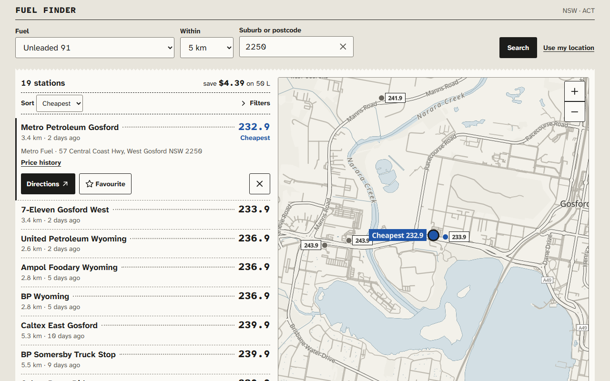
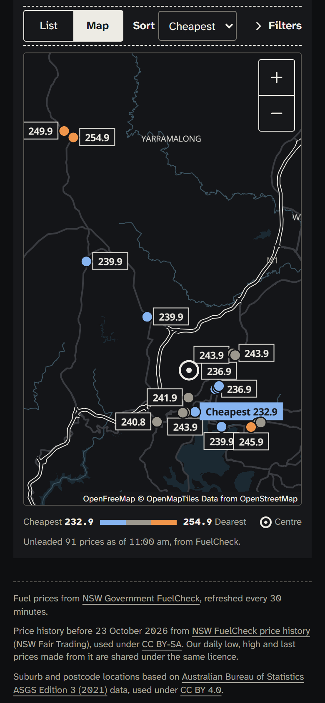
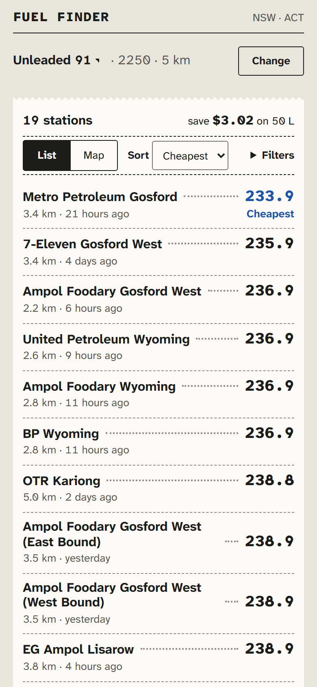
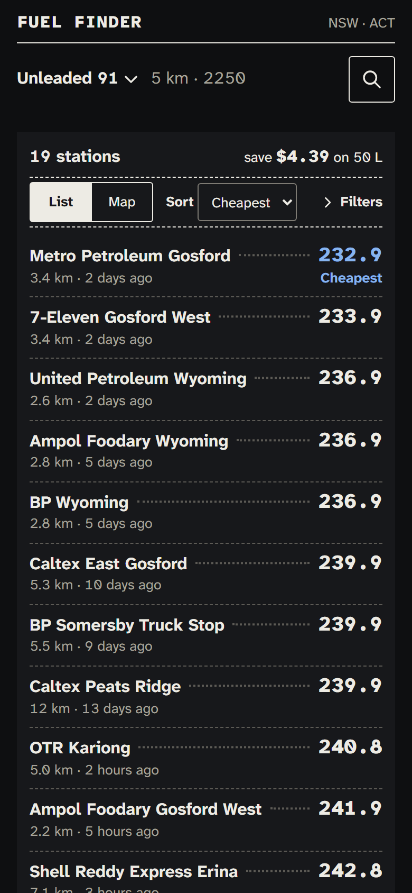
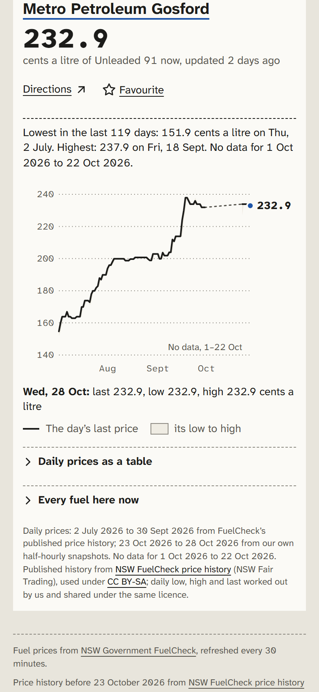
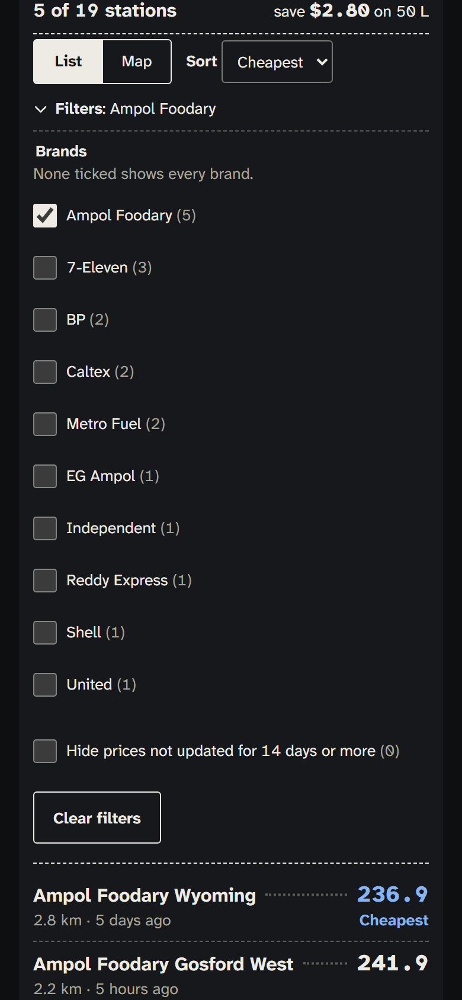
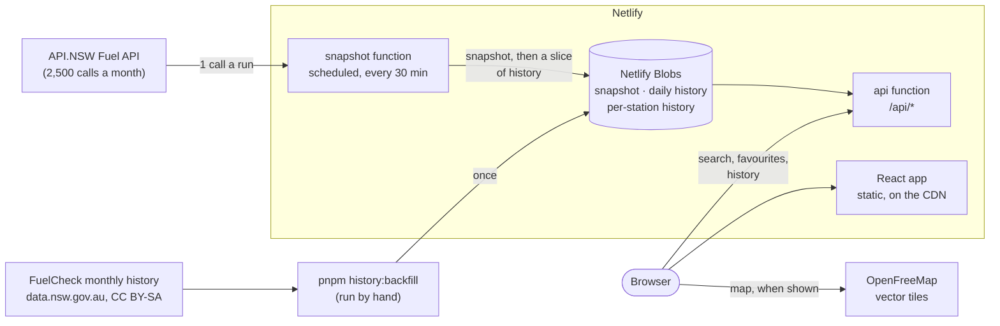

# NSW Fuel Finder

Live fuel prices for New South Wales and the ACT, cheapest first for the fuel
you use, on a list and a map, with four months of daily price history.

**[nsw-fuel-finder.netlify.app](https://nsw-fuel-finder.netlify.app)**

<p>
  
  
</p>

A portfolio project about live data, built as a deliberate contrast to
[Patchbay](https://github.com/Lyfe4/toolbox), a developer toolbox that never
touches the network. Here everything depends on someone else's API, quota and
uptime, and the interesting work is making that dependable.

| Phone, light                                                              | Phone, dark                                                                    | Price history                                                              | Filters                                                                        |
| ------------------------------------------------------------------------- | ------------------------------------------------------------------------------ | -------------------------------------------------------------------------- | ------------------------------------------------------------------------------ |
|  |  |  |  |

## How it works



Visitors never reach API.NSW. A scheduled function fetches every NSW price
every 30 minutes into Netlify Blobs, and the `/api` function answers searches
from that snapshot, held in memory by a warm instance.

## Key decisions

The full log, with what else was considered and the evidence behind each
choice, is in [docs/decisions.md](docs/decisions.md).

**A snapshot, so visitors cannot spend the quota.** API.NSW allows 2,500 calls
a month and locks the account after three failed sign-ins. A proxy calling it
per search would let one bot or one busy evening use up the month and break the
site for everyone. Instead the call count is a constant set by the schedule:
about 1,500 a month, whatever the traffic. The trade-off is freshness. A price
can be up to 30 minutes older here than on FuelCheck, though in practice most
prices are days old because retailers change them that rarely. A guard stored
in Blobs stops the job after a single refused sign-in (or two that got no
answer), well short of the three that lock the account, and only a person
restarts it, with `pnpm auth:reset`. `/api/status` reports, in plain English,
any gap between what the job wrote and what the API serves, and this month's
API.NSW calls against the budget. A stall of exactly that kind happened once, and is written up in
the log.

**Answers, not just a list.** A sentence over the results says the cheapest,
the average and what the difference is worth on a 50 L fill. Each station
says how far its price has moved today ("↓ 2.0 today", worked out from our
own history, shown only where it moved) and has directions in the phone's
own maps app. The list can be sorted nearest first and filtered by brand or
by price age, all in the URL, all on the device: the API never sees them, so
they cost no request. A search that finds nothing within the distance lists
the nearest stations up to 100 km instead of stopping. From 1440 px the
search form sits in a column of its own and stays in view.

**Accessibility as a requirement, not a pass at the end.** Native controls
wherever they fit: the fuel, distance and theme pickers are `<select>`s, which
every phone already knows how to show. Where a custom widget was needed (the
suburb search), it is Downshift's WAI-ARIA combobox, with its two
screen-reader gaps fixed and tested. Every action that removes its own button
says where focus goes next. The map's dots are not focusable; the list is the
keyboard path, because 500 Tab stops in map order would mean nothing. The
price chart is a slider over the days, with the summary in words and every
value in a table. axe runs in the unit tests in both themes, and against the
real site with its contrast rule on.

**Colour is never the only signal, and the colours survive colour blindness.**
The map's price bands were green, amber and red, which with deuteranopia are
nearly one colour. They are now blue, grey and orange, and a test simulates
three kinds of colour blindness and fails if any two bands come within ΔE 20.
The cheapest stations also say "Cheapest" in words, and old prices are
flagged in text.

**A map that costs nothing until it is shown.** MapLibre draws OpenFreeMap's
vector tiles with no key or account, and drops overlapping labels so a 25 km
Sydney search stays readable. It is also about 430 kB gzipped, more than the
rest of the app together. So it is a separate chunk, fetched only when a map is
on screen: a phone showing the list never downloads it. Its style, tile index
and fonts are fetched while it downloads. Bundle budgets in CI hold the first
load to its current size and give the map its own ceiling.

**Four months of history from day one, by joining open data to our own.**
API.NSW has no history, so the job keeps a daily low, high and last price from
launch. The months before launch come from FuelCheck's published monthly files,
which list every price change but have no station codes. Stations are matched
by address, then by name within the postcode, and anything ambiguous is left
out rather than guessed: 99.2% of price changes matched. The chart reads two
small per-station files, which the scheduled job keeps up to date 200 stations
a run.

**No router, no state library.** The screen's state is its search, so it lives
in the URL (`?fuel=U91&query=2250&radius=10&history=972`), which makes every
view shareable and makes Back undo a search or close a station's history.
TanStack Query holds what the API said. A router was reconsidered when the
history view arrived and still was not worth a dependency for one URL
parameter.

**Locked down where it matters.** A Content-Security-Policy allows scripts
only from the site itself plus one inline script by exact hash (the no-flash
theme script), and styles only from our own stylesheets. The map's worker is
our own file, so it needs no `blob:`. The browser check fails on any policy
violation. `/api/*` is rate limited at Netlify's edge (120 requests a minute
per address), and tells the CDN which query parameters its answers depend on,
so junk parameters cannot force a function to run. Everything else has a
limit of its own (600 requests a minute per address, about 75 first visits),
so one machine cannot spend the hosting account's shared bandwidth in
minutes.

## Known limitations

- **NSW and the ACT only.** That is what FuelCheck covers.
- **As fresh as retailers report.** Stations must report a change within 30
  minutes, and the snapshot adds up to 30 more. A price untouched for 14 days
  or more is flagged.
- **"Today" is against our own records.** A price's move today compares it
  with the last price our 30-minute snapshot saw yesterday, so a change made
  and undone between two snapshots is not seen.
- **History has a gap from 1 to 22 October 2026.** The published history
  currently ends on 30 September, and our own starts on 23 October. The gap is
  shaded "No data" until FuelCheck publishes October (see Maintenance).
- **Suburbs are found by the ABS's 2021 boundaries**, so a suburb created or
  renamed since then is found only by postcode.
- **The map needs WebGL.** Without it the list still has every station.

## Running it locally

You need Node 22 and pnpm 11 (`corepack enable`), and for the live data an
API.NSW account with access to the Fuel API.

```bash
pnpm install
cp .env.example .env      # then fill in FUEL_API_KEY and FUEL_API_SECRET
pnpm dev                  # the app alone, at http://localhost:5173
pnpm dev:netlify          # the app and the functions together, at :8888
```

> **Careful with the snapshot job.** Running it locally
> (`netlify functions:invoke snapshot`) makes real API.NSW calls from the same
> monthly quota production uses. Three failed sign-ins in a row lock the
> account. The job's guard stops after one, but a local run keeps its own
> record, so it can add a second failure to production's. If `/api/status`
> reports a failed run, do not run the job locally until the cause is known.
> Nothing else here calls API.NSW. `netlify dev --offline` runs the app and
> the API without the production credentials. On Windows, `netlify dev` needs
> Developer Mode on.

| Command                  | What it does                                                                |
| ------------------------ | --------------------------------------------------------------------------- |
| `pnpm test`              | Unit and integration tests (Vitest, Testing Library, axe), no network       |
| `pnpm typecheck`         | TypeScript across the app, functions and config                             |
| `pnpm lint`              | ESLint, including jsx-a11y and type-aware rules                             |
| `pnpm build`             | The production build                                                        |
| `pnpm bundle:check`      | Bundle budgets, after a build                                               |
| `pnpm check:browser URL` | Real-browser smoke check (Playwright): search, map, filters, history, CSP   |
| `pnpm check:a11y URL`    | axe with colour contrast in both themes, first paint, five screen sizes     |
| `pnpm serve:headers`     | The build with production's security headers, to test a CSP change first    |
| `pnpm screenshots`       | These screenshots and the social card, from committed fixtures (`--record`) |
| `pnpm history:backfill`  | Rebuild history from FuelCheck's monthly files (`--upload` writes to Blobs) |
| `pnpm auth:reset`        | Show the lockout guard's record and, if you type `reset`, clear it          |

CI runs typecheck, lint, format, tests, build and the bundle budget on every
pull request and every push to `main`. `main` is protected: each change
arrives as a pull request that has passed CI, squash-merged so every commit
on `main` builds on its own. Merging deploys production. Deploy previews have
no API.NSW credentials and do not run the snapshot job. The browser checks
need a running site, so they are run by hand against `pnpm serve:headers`, a
deploy preview or production.

## Maintenance

- **Early November 2026:** FuelCheck publishes October's history. Run
  `pnpm history:backfill --months 4 --upload` to fill the 1-22 October gap.
  It writes to production Blobs and needs `NETLIFY_SITE_ID` and
  `NETLIFY_AUTH_TOKEN`. A Netlify personal access token reaches the whole
  account, so make one just for this (User settings > Applications > New
  access token) with the shortest expiry offered, and delete it when the
  upload is done. Then once a quarter, or whenever a longer chart is wanted.
- **If prices look stuck**, open `/api/status` first, then
  `netlify logs --function snapshot`. `credentials_locked` means the guard has
  stopped the job: fix the cause (the key, the secret, or the app's Fuel API
  subscription), then run `pnpm auth:reset` with the same kind of short-lived
  token.
- **If `check:browser` says Netlify's badge is back**, the policy is blocking
  it: decide whether to allow it again (docs/decisions.md, round 9).
- **UptimeRobot** checks
  [`/api/status`](https://nsw-fuel-finder.netlify.app/api/status) every 15
  minutes and emails the owner when it is not 200: the site is down, or the
  status is a 503 (a stalled or failing snapshot job, the lockout guard
  stopped, or more than 2,000 API.NSW calls this month). Each check is a
  function run (about 2,900 a month), so not more often. When an alert
  arrives, open `/api/status`: its `problems` say which.
- **Keep watching the quota** on the API.NSW dashboard (about 1,500 calls a
  month at this schedule; `/api/status` shows our own count) and Netlify's
  usage page. On Legacy Free, reaching any limit pauses every site on the
  account until it is upgraded to a paid plan.

## Privacy

No account, no cookies, no analytics and no tracking. "Use my location" is
used in your browser, and only a position rounded to about 1 km is sent to
this site, whose code never stores or logs it; nor does it store searches.
Favourites and your theme stay on this device. Netlify, the host, counts
requests per internet address for a minute, to rate-limit the site. When the
map is shown, your browser fetches tiles from OpenFreeMap, which sees your
internet address and the area on screen; nothing is fetched from it before
then. Directions open Apple or Google Maps with the station as the
destination, and your position is not passed on. The same note is on the
site at [/privacy.html](https://nsw-fuel-finder.netlify.app/privacy.html).

## Data and licences

- **Live prices:** [NSW Government FuelCheck](https://www.fuelcheck.nsw.gov.au/)
  via the API.NSW Fuel API, under its terms of use.
- **Price history** before 23 October 2026:
  [FuelCheck price history](https://data.nsw.gov.au/data/dataset/fuel-check),
  © NSW Fair Trading, [CC BY-SA](https://creativecommons.org/licenses/by-sa/4.0/).
  The daily low, high and last prices derived from it (and from our own
  snapshots) are shared under **CC BY-SA 4.0**, and credited wherever shown.
- **Suburbs and postcodes:** Australian Bureau of Statistics,
  [ASGS Edition 3](https://www.abs.gov.au/statistics/standards/australian-statistical-geography-standard-asgs-edition-3)
  (2021), [CC BY 4.0](https://creativecommons.org/licenses/by/4.0/), built by
  `scripts/build-gazetteer.js`.
- **Map:** [OpenFreeMap](https://openfreemap.org/) tiles,
  © [OpenMapTiles](https://openmaptiles.org/), data ©
  [OpenStreetMap](https://www.openstreetmap.org/copyright) contributors, drawn
  with [MapLibre GL JS](https://maplibre.org/).
- **Code:** [MIT](LICENSE).
