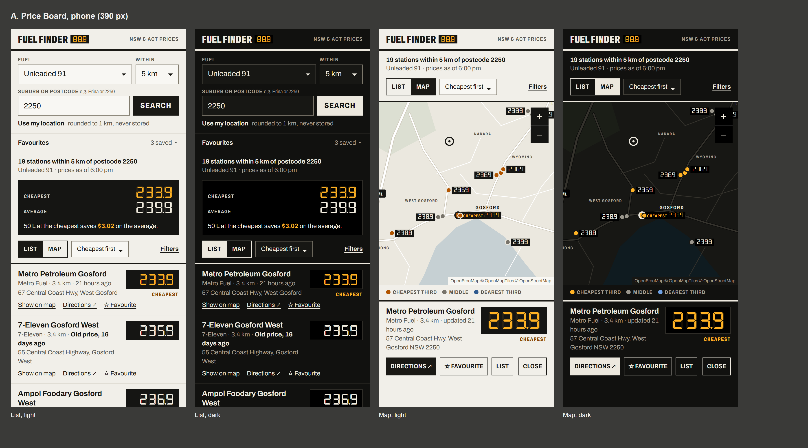
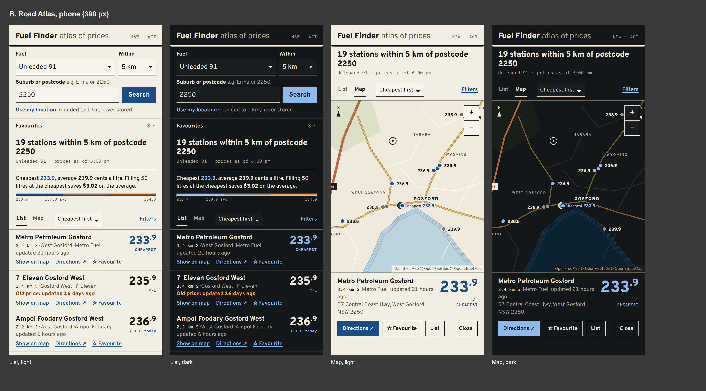
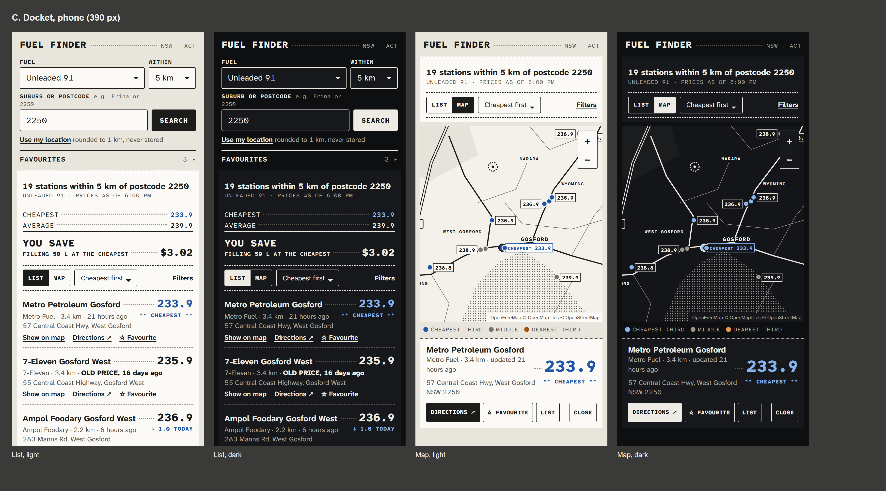

# Redesign, part 1: content review and three directions

Proposals only. Nothing in `src/` has changed. The mockups are static HTML
built on the real screenshot fixtures (postcode 2250, U91, 24 Oct 2026).

- `png/compare-list-light.png`, `png/compare-list-dark.png`: the three List screens side by side
- `png/<direction>-sheet.png`: List and Map, light and dark, for each direction
- `png/legibility.png`: each price face at 12–40 px, sharp and blurred
- `node docs/design-directions/render.mjs` re-renders all of them (Playwright)
- `node docs/design-directions/palettes.mjs` checks every proposed palette with
  the maths in `src/styles/tokens.test.ts` (AA contrast, band ΔE ≥ 20 under
  three kinds of colour blindness). All six palettes pass.

One mockup row (the second) is aged to 16 days to show the old-price
treatment; nothing in the fixtures is that old.

## Step 1: content and layout

**The main problem is not style, it's order.** On a 390 × 844 phone after a
search, the first station price is about 1.4 screens down. Above it: title,
tagline, a theme picker, a boxed form (about 360 px), Favourites, a two-line
heading, the tinted summary box, Sort on its own row, Filters on its own row,
and a full-width List/Map switch. Each station card is about 260 px tall, so a
phone shows two. In all three mockups the first price is at about 520 px and
three to four stations fit on the first screen, with every control kept.

### Phone, results state, in order

| #   | Element                   | Proposal                                                                                                                                                                                                                                                                                                                   | Why                                                                                                                                                                            |
| --- | ------------------------- | -------------------------------------------------------------------------------------------------------------------------------------------------------------------------------------------------------------------------------------------------------------------------------------------------------------------------- | ------------------------------------------------------------------------------------------------------------------------------------------------------------------------------ |
| 1   | Masthead                  | One 48 px line: wordmark "Fuel Finder" plus a quiet "NSW · ACT". Tagline only in the idle state. **Theme select moves to the footer** (still a labelled native `<select>`).                                                                                                                                                | Theme is set once; it was costing a row above every search.                                                                                                                    |
| 2   | Search form               | No box. Row 1: Fuel and Within side by side. Row 2: place input with Search beside it. Row 3: "Use my location" as a text button with "rounded to 1 km, never stored". The hint shortens to "e.g. Erina or 2250" and moves onto the label line (still `aria-describedby`, not a placeholder). About 170 px instead of 360. | Fuel stays visible and changeable after a search: I did **not** collapse the form behind a "Change search" bar. Switching fuel after seeing results is a common second action. |
| 3   | Favourites                | Stays a `
`, one 40 px line ("Favourites · 3"). Open by default with no search, as now. Rows use **the same anatomy as station rows** (price leading, big) instead of "233.9 cents a litre, updated…" in small text.                                                                                               | Returning users open the app to check their own stations. The price should be the hero there too.                                                                              |
| 4   | Results heading           | Same words ("19 stations within 5 km of postcode 2250"), smaller. "Unleaded 91 · prices as of 6:00 pm" right under it.                                                                                                                                                                                                     | The heading text is the screen-reader landmark and focus target. Keep it, just stop it competing with prices.                                                                  |
| 5   | Summary sentence          | Keep the visually-hidden full sentence exactly as now. The visible version becomes the direction's hero (a mini pylon, a scale bar, a docket total). No tinted box.                                                                                                                                                        | It's the answer to the search. Today it looks like an info banner.                                                                                                             |
| 6   | Tools                     | **One row**: List/Map switch, Sort select, Filters disclosure. The switch shrinks from full-width buttons to a segmented control. Filters still opens below the row.                                                                                                                                                       | It was three rows (about 280 px).                                                                                                                                              |
| 7   | Station row               | See below. About 110 px, no card.                                                                                                                                                                                                                                                                                          |                                                                                                                                                                                |
| 8   | "Show more" and the count | Unchanged behaviour, restyled.                                                                                                                                                                                                                                                                                             |                                                                                                                                                                                |
| 9   | Footer                    | Same credits (CC BY-SA and CC BY attribution must stay), set smaller as a "Data" block, plus the theme select and the Privacy link.                                                                                                                                                                                        |                                                                                                                                                                                |

### Station row anatomy

- **Primary:** price (largest thing in the row, right column, aligned on the
  decimal) and station name (the history link, still the `<h3>`). Reading
  order stays name, then price.
- **Secondary, one line:** brand · distance · "21 hours ago". An old price
  becomes **"Old price, 16 days ago"** in bold, in words.
  "Cheapest" and "↓ 1.0 today" sit under the price, in the accent colour plus words.
- **Address:** kept, but shortened: the trailing "NSW 2250" goes (the
  search is local), and ALL-CAPS addresses are title-cased ("57 Central Coast
  Hwy, West Gosford"). The full address stays in the selected card, the
  history view and Directions. Risk: the title-casing regex mangling unusual
  names ("McGraths Hill" is fine, "BP" in an address would become "Bp"). It
  only runs on strings that are entirely upper case, and it needs a test list
  of real addresses from the fixtures.
- **Actions:** all three stay, on one line of small text buttons: Show on
  map · Directions ↗ · ☆ Favourite. Not hidden behind an expander: "Show on
  map" is the keyboard path to the map (one Tab stop per station), and
  hiding it would add a Tab stop and a hidden state.
- **Removed:** the card box, the "¢/L" under every price in A and C (it's in
  the summary and the column), the "Price updated" prefix.
- **B only:** distance gets a compass point from the search centre ("3.4 km
  S"). That's useful real information, and it reads like an atlas index. For a postcode
  search it's from the postcode's centre, which is approximate. I'd keep it
  only if you pick B, and label it as from the search centre in the
  legend.

### Other screens

- **Selected station (phone map):** a strip under the map, not a floating
  card: name, the price at its largest anywhere in the app, meta, full
  address, then Directions (primary), Favourite, List, Close. Same focus
  behaviour.
- **History view:** reorder to price now, then the summary sentence, then
  **the chart**, then "Every fuel here now" and the daily table. Today the
  every-fuel table sits above the chart and pushes it below the fold. The
  heading keeps "Price history" so its accessible name doesn't change
  (visually: an eyebrow "Price history · Unleaded 91" over the station name).
- **Empty and error states:** same copy (it's good). Shown as plain text
  with a rule and the action button. No tinted alert boxes. `role="alert"`
  is unchanged.
- **Map legend:** words unchanged ("Cheapest third / Middle / Dearest
  third"). It becomes part of each direction's language (the LED brightness
  scale in A, the scale bar in B, the docket key in C).

### Renames

- **"NSW Fuel Finder" → "Fuel Finder"**, with the region as content ("NSW ·
  ACT") so QLD or SA can be added without rebranding. The `<h1>`, `<title>`,
  manifest `name`, OG card and README change in part 2. The domain stays.
- Nothing else. "Favourite", "Show on map" and "Directions" are clear.

### Risks this raises (and the test for each)

- **Sticky tools row (considered, not proposed).** Making the List/Map row
  sticky would help long lists, but a sticky bar can cover the focused row
  (WCAG 2.4.11). If you want it: `scroll-padding-top` equal to its height,
  plus a check:browser test that tabs through 20 rows and asserts each focused
  element's rect is below the bar.
- **Text zoom 200% and 320 px wide.** The fixed-width price column must wrap,
  not clip. Add 320 px with `font-size: 200%` to `check:a11y`'s screen sizes.
- **Two stations with the same brand in one suburb** (the East Bound and
  West Bound Ampol in the fixtures) differ only by name suffix and address. That's
  another reason to keep the short address in the row.

## Step 2: three directions

All three share the content above, one accent colour used only for meaning
(cheapest, moved today), tinted neutrals, rules not cards, a 4 px spacing
scale (4/8/12/16/24/32), and Utopia steps from 320 to 1440 px (ratio 1.2 to
1.25), already used in the mockups as `--step--2` … `--step-3`.

### A. Price Board

**Rationale.** The roadside pylon: a black sign window with lit numerals,
small condensed caps beside it, and nothing else. Every price sits in its
own small black window. That's the one box in the interface, and the thing
you'd recognise from a crop. The cheapest price is "lit" amber. Everything
else is pylon-white body (or night-panel in dark), with heavy 3 px rules like
the sign's frame. The summary becomes the search's own little pylon
(Cheapest / Average), with the saving underneath.

- **Type:** DSEG7 Classic Bold for prices only (keshikan, OFL 1.1, woff2
  ships in the `dseg` npm package, **5.1 kB**). Archivo, variable wght and
  wdth (Omnibus-Type, OFL 1.1, fontsource woff2, about 35 kB wght-only or 90 kB with
  width). Its condensed caps are the grade labels.
- **Palette:** light: body `#f1efe9`, ink `#1a1915`, muted `#5b5850`,
  window `#151513`, LED `#f2ede0`, lit `#ffb224`, accent text `#8a4600`. Dark:
  `#11110f` / `#ece8de`, windows pure black, accent `#ffb224`. Bands:
  amber / grey / slate blue ("the cheapest is lit, the dearest is dim").
- **Price:** DSEG numerals, LED colour on the window. A ghost "888.8"
  at 8% sits behind, `aria-hidden`. The window has a fixed width, so a font
  swap cannot shift layout.
- **Row:** name and meta left, window right, CHEAPEST in condensed caps
  under it.
- **Map:** warm grey land and white roads. Every price label is a little
  black sign tag with LED numerals. That's the map's signature, cheap to do with
  MapLibre `icon-text-fit` on a 9-slice sprite.
- **Legibility: a real problem, see `png/legibility.png`.** DSEG's decimal
  point is zero-width and sits in the gap between digits. At 12–16 px, and
  for anyone with blurred vision at any size, "171.7" reads as "17 17" and
  "188.0" as "1880". The segment "1" also sits at the right of its cell. My
  verdict: A is only viable if DSEG is limited to ≥ 24 px, the tenth digit is
  set smaller and offset (as real pylons do), and the decimal is drawn as a
  separate real "." in the text face. Everywhere smaller (favourites, the
  table, map tags) uses Archivo with tabular figures. That fixes it, but it
  dilutes the idea. Also, under forced-colours mode the windows lose their
  black. The numerals stay readable, but the identity disappears.

### B. Road Atlas

**Rationale.** The Gregory's / UBD street directory: paper, ink, hairline
double rules, water in blue with waterlining, highways in ochre-red, and an
index set in a typeface from highway signs. The list reads like the atlas
index (name, locality, distance and bearing, price), and the summary is the
plate's key: the sentence plus a scale bar of the price spread, coloured by
the same three bands as the map, so it doubles as the map legend.

- **Type:** Overpass, variable wght (Delve Fonts for Red Hat, derived from
  Highway Gothic, OFL 1.1, woff2 39 kB). Overpass Mono, variable (same
  family, OFL 1.1, 22 kB) for the small data: distance, bearing, "as of" times.
  Overpass has proportional figures by default, so `tabular-nums` is
  required. It has `tnum` (checked with fontTools).
- **Palette:** light: paper `#f2ede1`, ink `#1d1b16`, muted `#5c5749`,
  rules `#d3cab6`, accent atlas blue `#1b4d87`. Dark ("night atlas"):
  slate `#15181a`, `#e9e4d6`, accent `#8db9ec`. Bands: blue / grey-brown /
  contour ochre, the same hue logic as today's tested bands.
- **Price:** Overpass ExtraBold at about 30 px, with the tenth set as a raised
  smaller ".9", the US/older-pylon convention. It's still the text "233.9".
  Cheapest in blue.
- **Row:** index entry: bold name; mono "3.4 km S" · locality · brand;
  updated time; actions. Price on the right.
- **Map: the map leads here.** Paper land, blue waterlining on the coast
  (MapLibre `line-offset` rings on the water layer), ochre motorways with ink
  casing, letter-spaced caps for suburbs, italic blue water names, prices as
  ink text on a paper halo, and a north arrow. On wide screens the map takes
  the larger column and the list becomes the index beside it. **On phones it
  can't lead**: showing a map above the list would download MapLibre (about 430 kB
  gzipped) for every phone visit, undoing round 4's "a phone showing the list
  never downloads it". So the phone keeps the List/Map switch.
- **Legibility:** good at every size (see the strip). This is the most
  conservative of the three.

### C. Docket

**Rationale.** The servo docket: a strip of thermal paper torn off at the top,
dotted leaders from station to price, a dashed tear between line items, and
the saving printed as the total under a double rule: "YOU SAVE … $3.02".
Carbon-copy blue is the one accent (cheapest, moved today). Red was rejected
because red reads as "dearer". The map is a thermal print: ink roads, a
double-line motorway, halftone-dot water, and boxed price tags.

- **Type:** Atkinson Hyperlegible Next (Braille Institute, OFL 1.1, variable
  woff2 34 kB) for names and sentences. Atkinson Hyperlegible Mono (same
  project, OFL 1.1, 18 kB) for figures and labels. One superfamily, **designed
  for low-vision readers**: slashed zero, open 3/5/6/9, distinct 1/7. That's
  the strongest accessibility story of the three, and the mono has no
  OpenType tricks to forget, because every glyph is tabular.
- **Palette:** light: counter `#e8e5dc`, thermal paper `#fbfaf6`, ink
  `#1c1c1a`, muted `#58564f`, accent carbon blue `#1f55a8`. Dark: `#0e0f11`,
  night docket `#17181b`, ink `#edebe4`, accent `#86b4f0` (hue 213°, kept well
  away from indigo). Bands: carbon blue / grey / amber-brown.
- **Price:** Atkinson Mono ExtraBold, about 23 px in rows and 34 px in the
  stub, with dotted leaders from the name.
- **Row:** `Name ········ 233.9`, then brand · distance · age with
  `** CHEAPEST **` right-aligned, then the address and actions. The asterisks
  must be `aria-hidden` in the build, or screen readers say "star star".
- **Map:** monochrome. Halftone water needs a `fill-pattern` sprite on our
  origin (CSP is fine: same origin).
- **Risk:** the docket strip is a container, which the brief prefers to
  avoid. It is one container for the whole results area with a torn edge,
  not a card per item, and the items inside use rules. A dense mono texture
  can feel busy at desktop widths. In part 2 I'd keep the mono for figures and
  small labels only, as here, not body text.

## Fonts: what each direction costs

|     | First-paint face to preload                                              | Total woff2           | Fallback for zero CLS                                                                            |
| --- | ------------------------------------------------------------------------ | --------------------- | ------------------------------------------------------------------------------------------------ |
| A   | Archivo (35 kB wght; 90 kB with wdth, subset to Basic Latin about 45 kB) | + DSEG 5 kB           | Arial Narrow / Arial with `size-adjust`; DSEG in a fixed-width window                            |
| B   | Overpass 39 kB                                                           | + Overpass Mono 22 kB | Arial + `size-adjust`, `ascent-override` from Overpass's metrics (upm 2000, asc 1766, desc 766)  |
| C   | Atkinson Next 34 kB                                                      | + Atkinson Mono 18 kB | Verdana / Arial + overrides; mono fallback `ui-monospace` with `size-adjust` to 0.632 em advance |

Library and platform behaviour to rely on, or watch:

- **`font-variant-numeric: tabular-nums`** only works when the font has a
  `tnum` feature. Overpass, Archivo and Atkinson Next have one; the monos and
  DSEG are fixed-width anyway. Overpass and Atkinson Next have
  _proportional_ default figures, so forgetting the property breaks decimal
  alignment silently.
- **`<link rel="preload" as="font">` needs `crossorigin`**, even on our own
  origin, or the browser downloads the font twice. Fonts go in `public/fonts/`
  (stable URLs for the preload), with versioned file names and a long
  `Cache-Control` in `netlify.toml`.
- **`size-adjust` / `ascent-override`** are in Chromium, Firefox and Safari 17+.
  Older Safari ignores them, so it gets a small shift on swap. The browser
  check's CLS test runs in Chromium, so it wouldn't catch that.
- **OFL Reserved Font Names:** DSEG has one, so subsetting it creates a
  "Modified Version" that may not be called DSEG. It's 5 kB, so ship it
  unmodified. The fontsource files (Archivo, Overpass, Atkinson) have no RFN
  and are already Latin subsets.
- **Bundle budgets:** `bundle:check` counts initial JS and CSS, not fonts.
  I'd add a fonts budget (first-paint font ≤ 45 kB, all fonts ≤ 70 kB) in
  part 2 rather than let them grow unwatched. CSS headroom is 1.4 kB. The
  redesign removes the card and tint rules it adds back, but `@font-face`
  plus fallback blocks are about 0.8 kB, so expect to raise the CSS budget to 24 kB
  with a note.

## Map label typography (optional): my assessment

MapLibre draws labels from SDF glyph PBFs, not woff2. Today they come from
OpenFreeMap (Noto Sans Regular, Bold and Italic).

- **Generation:** a one-off script, maplibre/font-maker (browser or Node)
  or `build_pbf_glyphs`, run on the OFL TTFs, committed output. Licensing is
  fine: OFL allows this, with the licence alongside.
- **Size:** each font stack is 256 range files. Only 0-255 and 256-511 matter
  for NSW place names (about 60–80 kB and 20–40 kB). Two stacks (regular and bold, plus
  italic for B's water) come to about 250 kB in the repo, and a map view fetches about
  100–150 kB once, cached.
- **CSP:** none needed. Fetched via `connect-src 'self'`.
- **Cost:** that bandwidth moves from OpenFreeMap to our Netlify account
  (the 100 GB/month that pauses all 16 sites). It's about +15% on top of the 1 MB map
  chunk per first map view. That's acceptable, but it's real.
- **Failure mode:** a label with a glyph outside the generated ranges
  (Vietnamese diacritics, say) draws with that glyph missing. MapLibre can't
  fall back across font stacks from a static host. Mitigation: generate
  every range the font covers, since empty ranges are tiny.
- **Verdict:** worth it for **B**, where the map is half the identity and
  letter-spaced Overpass caps are what makes it look like an atlas. For A and C,
  restyle colours only (cheap: the existing runtime override in
  `mapStyle.ts`) and keep Noto labels.

## My recommendation

**C, Docket**, with one idea borrowed from B: the price-spread scale bar
under the total, as the map legend. C is the most recognisable from a
crop (leaders, torn edge, `** CHEAPEST **`, halftone water). Its typeface was
built for low vision, so legibility comes from the font itself, not from
workarounds. It costs the least (52 kB of fonts, no glyph PBFs), and its voice fits the plain-English copy.
B is the safest and most "high-end". A has the strongest single image, but its
price face fails the legibility check unless it's watered down.

Waiting for your choice before part 2.
